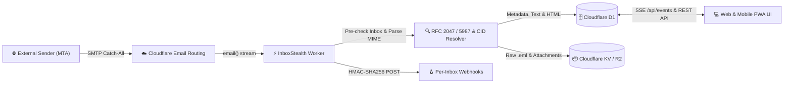

<div align="center">

# ✉️ InboxStealth

**Self-Hosted Multi-Domain Disposable & Temporary Email Platform**  
*Built on Cloudflare Workers · D1 (SQLite) · KV / R2 · Email Routing · Zero Runtime Dependencies*

[](https://workers.cloudflare.com/)
[](https://developers.cloudflare.com/d1/)
[](./package.json)
[](./public/manifest.webmanifest)
[](./LICENSE)

</div>

---

## ⚡ Overview

**InboxStealth** turns your own Cloudflare domains into a private, multi-domain temporary inbox platform. Unlike public disposable email services whose domains are blocklisted everywhere, InboxStealth runs entirely on **your own domains and Cloudflare edge account**—complete with **automatic OTP code extraction**, **1-click verification link detection**, **realtime SSE streaming**, **custom WebAudio notification sounds**, **TOTP 2FA**, and **role-based access control**.



---

## ✨ Highlight Features

| Category | Capability | Details |
| :--- | :--- | :--- |
| **🔢 Smart OTP & Links** | **Auto-Detect OTP Badge** | Automatically extracts 4–8 digit verification codes from subjects & bodies into a 1-click copy chip in the message list and reader header. |
| | **Auto-Copy OTP on Arrival** | Optional toggle that copies incoming OTP codes directly to your clipboard the moment a new email arrives. |
| | **1-Click Magic Link Bar** | Scores and surfaces verification, activation, reset, and magic login URLs at the top of the email with **Open Link ↗** and **Copy Link** buttons. |
| **📬 Multi-Inbox UX** | **Quick Inbox Switcher (`Ganti ▾`)** | Switch between all active addresses in 1 click directly from the inbox header bar. |
| | **Address Labels / Notes** | Tag any address with a custom note (e.g. `Netflix Trial`, `GitHub Staging`) and filter/search by address or label. |
| | **Permanent Pin (`Simpan Permanen`)** | Pin important inboxes so they and their messages never expire during scheduled cron cleanup. |
| | **Clean `⋯` Popup Actions** | Click any address to open its inbox immediately; manage QR codes, TTL extensions, exports, webhooks, and labels from a floating `⋯` menu. |
| **🔔 Realtime & Audio** | **Live SSE with Auto-Reconnect** | `● Live` status indicator powered by lightweight covering-index D1 polling and seamless cycle reconnection. |
| | **Custom Audio (IndexedDB + WebAudio)** | 4 built-in synthesizer tones (`Ding`, `Chime`, `Pop`, `Bell`) + upload custom audio up to **6 MB** (`.mp3`, `.wav`, `.ogg`, `.m4a`, `.aac`, `.opus`, `.flac`, `.webm`) decoded via `AudioContext.decodeAudioData()`. |
| | **Desktop Browser Notifications** | Native OS notifications on incoming mail with the extracted OTP code shown directly in the notification title. |
| **📨 MIME & Viewer** | **Zero-Dependency MIME Engine** | Full RFC 2047 (`?B?` / `?Q?` UTF-8 & emoji headers), RFC 5987 (`filename*=UTF-8''...`), exact multipart boundary matching, and **`cid:Content-ID` inline image resolution**. |
| | **Adaptive Sandboxed HTML Reader** | Isolated `<iframe sandbox="allow-popups allow-popups-to-escape-sandbox">` with auto-estimated height, 1-click **Perbesar (`82vh`)** expansion, and external image toggle. |
| **📦 Export & Hooks** | **JSON / CSV / ZIP `.eml` Export** | Export any inbox to structured JSON, UTF-8 BOM CSV (protected against CSV Formula Injection), or a `.zip` archive bundling CSV + JSON + raw `.eml` files. |
| | **HMAC-SHA256 Webhooks** | Attach up to 3 webhook endpoints per inbox with `x-menyurat-signature` verification and strict anti-SSRF filtering. |
| **📱 Mobile & Themes** | **iOS Safari & Android Chrome Ready** | High-contrast Light & Dark Mode, `100dvh` dynamic viewport, iPhone notch/home-indicator `safe-area-inset`, `16px` anti-autozoom inputs, and responsive mobile search & auto-scroll. |

---

## 🛡️ Security Architecture

> [!IMPORTANT]
> InboxStealth is hardened out-of-the-box against cross-user inbox collisions, SSRF, CSRF, XSS, CSV formula injection, and storage exhaustion.

- **Dynamic SHA-256 Inline Script CSP**: Computes SHA-256 hashes of inline scripts at runtime (`cspForHtml`) with `frame-ancestors 'none'`, `X-Frame-Options: DENY`, `Strict-Transport-Security`, `Cross-Origin-Opener-Policy: same-origin`, and `Cross-Origin-Resource-Policy: same-origin`.
- **CSRF Origin & `Sec-Fetch-Site` Guard**: Rejects cross-origin state-changing requests (`POST`, `PATCH`, `DELETE`) authenticated via cookies with `403 csrf_blocked`.
- **Inbox Ownership & Anti-Collision**: Prevents cross-user takeover or TTL sabotage on active/pinned addresses (`409 address_taken`) and purges prior messages/webhooks before recycling expired unpinned addresses.
- **Pre-Stream Catch-All Filtering**: Verifies target inbox existence and active TTL in D1 **before** reading the raw incoming email stream into Worker RAM, dropping catch-all spam at zero memory cost.
- **Session vs. API Key Privilege Isolation**: Scoped API keys (`mn_...`) can automate inbox and message workflows but cannot mutate account security settings (`password`, `2FA`, `api_keys`) or execute administrative mutations (`session_required`).
- **TOTP 2FA with Anti-Replay & Recovery Codes**: RFC 6238 TOTP with instant client-side QR code generation, 90-second single-use code replay blocking, and 8 single-use recovery codes.
- **SSRF-Hardened Webhooks**: Blocks IPv6 literals (`[::1]`, `[::ffff:...]`), private/loopback/CGNAT IPv4 ranges, single-integer/hex/octal IPs, self-domain loops, and HTTP `30x` redirects (`redirect: "manual"`).
- **Attachment MIME Sanitization & CSV Escaping**: Forces active MIME types (`image/svg+xml`, `text/html`, `*script*`) to `application/octet-stream` and neutralizes `=`, `+`, `-`, `@` formula prefixes in CSV exports.

---

## 👥 Role & Permission Matrix

| Capability | Member (`1`) | VIP (`2`) | Admin (`3`) | Owner (`4`) |
| :--- | :---: | :---: | :---: | :---: |
| **Default / Max Inbox TTL** | 7 days (fixed) | 1 hr – 90 days | 1 hr – 90 days | 1 hr – 365 days |
| **Active Inbox Quota** | 10 per domain | Unlimited | Unlimited | Unlimited |
| **VIP Premium Domains** | ❌ | ✅ | ✅ | ✅ |
| **Permanent Inbox Pinning** | ✅ | ✅ | ✅ | ✅ |
| **Per-Inbox Webhooks** | ❌ | ✅ (up to 3) | ✅ (up to 3) | ✅ (up to 3) |
| **Personal API Keys (`mn_...`)** | ✅ (up to 5) | ✅ (up to 5) | ✅ (up to 5) | ✅ (up to 5) |
| **Approve / Manage Users** | ❌ | ❌ | Members & VIPs | All Roles |
| **Manage Domains & Announcements** | ❌ | ❌ | ✅ | ✅ |
| **Audit Logs & Analytics Dashboard** | ❌ | ❌ | ✅ | ✅ |

---

## 📂 Repository Structure

```text
inboxstealth/
├── wrangler.toml            # Cloudflare Worker configuration template (sanitized)
├── package.json             # NPM scripts & Wrangler devDependency
├── schema.sql               # Full D1 SQLite database schema & composite indexes
├── seed.sql                 # Example initial domain seed
├── migrate-*.sql            # Incremental D1 schema migration scripts
├── deploy.ps1               # Interactive 1-click PowerShell deployment wizard
├── add-domain.ps1           # Automated Cloudflare Zone + Email Routing + D1 domain onboarding
├── check.ps1                # End-to-end health check script (UI, API, MX, Email Routing)
├── LICENSE                  # MIT License
├── public/
│   ├── index.html           # Desktop & iOS/Android mobile web UI (Light & Dark Mode)
│   ├── sw.js                # Service Worker for offline shell & asset caching
│   ├── qrcode.js            # Client-side QR generator for inbox addresses & 2FA TOTP
│   ├── manifest.webmanifest # PWA manifest
│   └── icon.svg             # Vector app icon
└── src/
    ├── index.js             # Cloudflare Worker entry: HTTP API, SSE, Email Routing, Cron GC
    ├── auth.js              # PBKDF2-SHA256 (100k iter), session store, cookie helpers
    ├── mime.js              # Zero-dependency MIME parser, RFC 2047/5987, cid: image resolver
    └── totp.js              # Zero-dependency RFC 6238 TOTP & recovery code generator
```

---

## 🚀 Quick Start & Deployment

### 1. Prerequisites
- **Node.js 18+**
- A **Cloudflare account** with at least one domain active on Cloudflare DNS

### 2. Clone & Create Cloudflare D1 + KV Resources
```bash
git clone https://github.com/aplatogg/inboxstealth.git
cd inboxstealth
npm install

# Authenticate with Cloudflare
npx wrangler login

# Create the D1 SQLite database
npx wrangler d1 create tempmail_db

# Create the KV namespace for raw .eml archives & attachments
npx wrangler kv namespace create FILE_KV
```

### 3. Configure `wrangler.toml`
Open `wrangler.toml` and fill in your generated resource IDs:
```toml
[[d1_databases]]
binding = "DB"
database_name = "tempmail_db"
database_id = "<YOUR_D1_DATABASE_ID>"

[vars]
DEFAULT_DOMAIN = "mail.yourdomain.com"
OWNER_EMAIL = "you@yourdomain.com"
TURNSTILE_SITE_KEY = "" # Optional Cloudflare Turnstile Site Key

[[kv_namespaces]]
binding = "FILE_KV"
id = "<YOUR_KV_NAMESPACE_ID>"
```

### 4. Initialize Database Schema & Seed Domains
```bash
# Apply the full D1 schema
npx wrangler d1 execute tempmail_db --file=./schema.sql --remote

# Edit seed.sql with your domain(s), then execute:
npx wrangler d1 execute tempmail_db --file=./seed.sql --remote
```

### 5. Optional: Enable Cloudflare Turnstile Bot Protection
If you use Cloudflare Turnstile on login/registration, set your secret key via Wrangler secrets (never committed to Git):
```bash
npx wrangler secret put TURNSTILE_SECRET
```
*(And set `TURNSTILE_SITE_KEY` in `wrangler.toml` `[vars]`—the Worker automatically injects it into the HTML `<meta name="turnstile-sitekey">` tag at runtime).*

### 6. Deploy to Cloudflare Workers
```bash
npm run deploy
```

### 7. Connect Cloudflare Email Routing (Catch-All)
For each domain you want to use for receiving disposable emails:
1. Open **Cloudflare Dashboard → Your Domain → Email → Email Routing** and click **Enable**.
2. Go to **Routing Rules → Catch-all address**, set Action to **Send to a Worker** → select `tempmail`.
3. Add or toggle the domain in the **Domain** tab of the Web UI (or automate the entire DNS + Email Routing + D1 setup with `pwsh -File .\add-domain.ps1 -Domain yourdomain.com`).

---

## 🔌 REST API & CLI Automation

All endpoints accept either a browser session cookie (`mn_session`) or a personal API key (`x-api-key: mn_...` or `Authorization: Bearer mn_...`).

```bash
export API_KEY="mn_your_api_key_here"
export BASE_URL="https://mail.yourdomain.com"

# 1. Create a random disposable inbox with a label
curl -s -X POST "$BASE_URL/api/new?domain=mail.yourdomain.com&note=GitHub+Test" \
  -H "x-api-key: $API_KEY"

# 2. Create or select a custom inbox with a 30-day TTL (VIP+)
curl -s -X POST "$BASE_URL/api/custom" \
  -H "x-api-key: $API_KEY" \
  -H "content-type: application/json" \
  -d '{"local":"dev.team","domain":"mail.yourdomain.com","ttl":2592000,"note":"Staging"}'

# 3. Poll inbox messages
curl -s "$BASE_URL/api/inbox/dev.team@mail.yourdomain.com" \
  -H "x-api-key: $API_KEY"

# 4. Export inbox as a ZIP bundle (CSV + JSON + raw .eml files)
curl -s -L "$BASE_URL/api/inbox/dev.team@mail.yourdomain.com/export?format=zip" \
  -H "x-api-key: $API_KEY" -o inbox-backup.zip
```

### Endpoint Reference

| Method | Path | Auth | Description |
| :--- | :--- | :--- | :--- |
| `GET` | `/api/health` | Public | Health check (`{ ok: true, time }`) |
| `GET` | `/api/announcement` | Public | Active global banner announcement |
| `POST` | `/api/auth/register` | Public | Register a new account (`OWNER_EMAIL` auto-bootstraps as `owner`) |
| `POST` | `/api/auth/login` | Public | Authenticate with email, password, and optional Turnstile token |
| `POST` | `/api/auth/2fa/verify` | Public | Complete 2FA login step with TOTP or recovery code |
| `GET` | `/api/domains` | Session / Key | List active domains |
| `POST` | `/api/new` | Session / Key | Create a random address (`domain`, `ttl`, `note`) |
| `POST` | `/api/custom` | Session / Key | Create or re-select a custom address (`local`, `domain`, `ttl`, `note`) |
| `GET` | `/api/my/inboxes` | Session / Key | List all active & pinned addresses owned by the user |
| `GET` | `/api/inbox/:address` | Session / Key | Get inbox metadata and latest 200 messages (with snippets) |
| `PATCH` | `/api/inbox/:address` | Session / Key | Update `note`, toggle `pinned`, or extend `ttl` / `days` |
| `DELETE` | `/api/inbox/:address` | Session / Key | Delete inbox, messages, attachments, webhooks, and KV blobs |
| `DELETE` | `/api/inbox/:address/messages` | Session / Key | Empty all messages & KV blobs in an inbox while keeping the address |
| `GET` | `/api/inbox/:address/export` | Session / Key | Export inbox (`?format=json`, `csv`, or `zip`) |
| `GET` | `/api/message/:address/:id` | Session / Key | Get full message details (`text_body`, `html_body`, `attachments`) |
| `DELETE` | `/api/message/:address/:id` | Session / Key | Delete a single message and its KV blobs |
| `GET` | `/api/message/:address/:id/eml` | Session / Key | Download raw RFC 822 `.eml` file |
| `GET` | `/api/attachment/:address/:msgId/:attId` | Session / Key | Download message attachment (MIME-sanitized) |
| `GET/POST/DELETE` | `/api/webhook/:address` | Session / Key | Manage per-inbox webhooks (VIP+) |
| `GET` | `/api/events?address=...` | Session / Key | Realtime Server-Sent Events (SSE) stream |
| `GET/POST/DELETE` | `/api/keys` | Session Only | Manage personal API keys (`mn_...`) |
| `POST` | `/api/auth/password` | Session Only | Change account password |
| `GET/POST` | `/api/auth/2fa/*` | Session Only | Configure, enable, or disable TOTP 2FA |

---

## 📄 License

Released under the [MIT License](./LICENSE).
